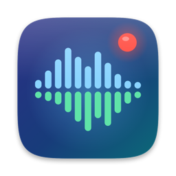

<p align="center"></p>

<h1 align="center">CallRecorder</h1>

<p align="center">Record FaceTime and Telegram calls on your Mac as two separate tracks — locally, from the menu bar.</p>

## What it is

CallRecorder lives next to the clock. During a call, click **Record Call** and it captures:

- **your voice** — from the microphone you're using (AirPods, for example);
- **the other side** — the audio of the calling app itself, not a microphone in the room, so no speakerphone needed.

When the call ends, recording stops on its own after 3 seconds. The two tracks are saved separately and
also mixed into a single file for listening. Separate tracks are groundwork for transcripts and summaries:
they tell you exactly who said what.

## Features

- Detects calls automatically: FaceTime (including FaceTime Audio, which macOS 27 runs through the Phone app) and Telegram Desktop.
- Two sample-aligned tracks plus a mixed `conversation.m4a`.
- Stops automatically when the call ends.
- Live levels for you and them, and a warning if the other side goes silent for too long.
- History: recent recordings right in the menu, plus a History window with search and filters.
- Player with a conversation waveform — them on top, you below. Click anywhere on it to jump there.
- Liquid Glass UI built from native macOS 26 components.
- Everything stays local: no servers, no analytics.

## Requirements

- macOS 26 Tahoe or later. Tested on macOS 27, MacBook Pro M1 Pro, AirPods 3.
- The call has to run **on this Mac**. A call on your iPhone isn't visible to the app, even with the Mac nearby.

## Install

### Download

Get `CallRecorder-0.1.dmg` from [Releases](https://github.com/charmant/CallRecorder/releases) and drag the app
to Applications.

The build isn't notarized by Apple, so macOS blocks the first launch. Open
System Settings → Privacy & Security → **Open Anyway**, or run:

```bash
xattr -dr com.apple.quarantine /Applications/CallRecorder.app
```

### Build from source

Requires Xcode 26 or later.

```bash
git clone https://github.com/charmant/CallRecorder.git
```

```bash
cd CallRecorder && ./scripts/install.sh
```

The script builds the app, installs it to `~/Applications` and launches it. It signs with the first
Apple Development certificate it finds, or ad-hoc if there is none.

On the first recording macOS asks for two permissions: **Microphone** (your track) and
**System Audio Recording** (their track).

## Usage

1. Start a call in FaceTime or Telegram on your Mac. The menu bar icon changes from a waveform to a phone.
2. Open the menu and click **Record Call** (or press Return). The menu shows a timer and both levels.
3. Hang up — 3 seconds later the recording is saved automatically. To stop earlier: **Stop** or ⌘.
4. The recording shows up under **Recent**. **History…** (⌘Y) lists all recordings by day.

## What gets saved

Each recording is a folder `~/Calls/<date time> <FaceTime|Telegram>/`:

| File | Contents |
| --- | --- |
| `local.caf` | your microphone |
| `remote.caf` | the calling app's audio (them) |
| `conversation.m4a` | both tracks mixed for listening |
| `session.json` | devices, formats, duration, detected issues, events |
| `waveform.json` | waveform for the player |
| `events.log` | what happened during the recording |

## How it works

```text
Them → FaceTime / Telegram → headphones
                │
                └─ Core Audio process tap ──┐
You  → microphone ───────────────────────────┤  one private aggregate device
                                             │
                                             └→ IOProc → two lock-free buffers → local.caf, remote.caf
                                                                                ↓ after stop
                                                                  conversation.m4a, waveform.json
```

- **Them.** `AudioHardwareCreateProcessTap` captures the calling processes' audio in `unmuted` mode, so you
  keep hearing the call. For FaceTime the voice is played by the system daemon `avconferenced`, not by the
  app itself — found from the diagnostics log of a real call.
- **You.** The microphone is part of the same aggregate device and drives its clock; the tap follows it
  (drift compensation). Both tracks arrive in one IOProc, so they line up sample-for-sample without manual
  syncing: on a one-hour call their length matched wall-clock time within 0.05 s.
- **Call start and end** are detected by whether the calling app holds the microphone
  (`kAudioProcessPropertyIsRunningInput`).
- **Reliability.** The IOProc only copies into ring buffers; a separate thread writes to disk. CAF headers
  are updated on every write, so audio already recorded stays readable after a crash. Lost frames are
  replaced with silence so the tracks never drift apart, and are noted in `session.json`.
- **Permissions.** There's no public API to check system audio access, and without it the tap silently
  delivers zeros. So the app uses the private `TCCAccessPreflight` / `TCCAccessRequest`, like
  [AudioCap](https://github.com/insidegui/AudioCap). That also means it isn't App Store material.

Details, the verification log and the test protocol are in [docs/DEVELOPMENT.md](docs/DEVELOPMENT.md).

## Limitations

- Start recording during the call: the source is found by the process that holds the microphone.
- Your microphone is recorded even when you mute it in FaceTime or Telegram — it's a separate capture.
- With the AirPods microphone the whole recording runs at the headset rate (16–24 kHz). Fine for speech.
- In a group call everyone on the other side ends up in one track.
- FaceTime is verified on a real one-hour call; Telegram not yet.

## Legal

In many places recording a conversation without the other person's consent is illegal, and in some
(Germany, for example) it's a criminal offence. Tell the other side the call is being recorded.

## Roadmap

- Local transcription (Whisper) with "You" / "Them" labels.
- Call summaries: topics, decisions, action items.
